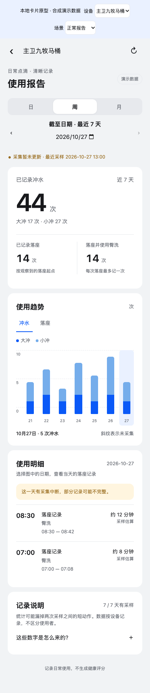

# 设备卡片内使用报告 · 实验分支

分支 `feat/in-card-usage-report`，基于 `6945d2a`。目标是每台马桶仍只有一张设备卡片，从卡片内进入报告，返回后仍是同一设备的控制页。

> 如改为全屋统一的“家庭报告中心”，可避开修改九牧页面的授权，但华为宿主发布和跨设备数据获取仍需分别解决；新发现的 Debug 版 H5 调试入口与企业准入要求见[家庭报告中心调研](family-report-center-research.md)。

## 当前交付与未打通部分

已实现独立使用记录库、按设备限定的只读 API、原创离线 H5 报告模块、本地卡片宿主演示、构建工具及自动化测试。报告不依赖 HA 仪表盘，不创建额外华为子设备。现场网关和现有 2QBR 产品身份未修改；这一分支尚未开启家中的实际使用采集。

**智慧生活真实卡片里的入口尚未发布。** `window.jomooReportHost` 是本项目定义的宿主接口，不是华为已经存在的 JSAPI。离线 ZIP 是供产品开发集成的模块，不是可以直接上传并替换九牧页面的成品插件，也不是已签名的 HarmonyOS HSP。

现有 2QBR 页面由厂商管理，没有报告路由或可配外链。下一步必须取得厂商产品页面开发权限，或获得自有产品开发资格并验证对应接入方式。新产品可能需要迁移绑定，不能假定保留当前身份即可替换页面。

## 视觉参考与公开证据

2026-10-27 直接核对以下公开来源，仅提取布局、色彩和能力信息，没有复制厂商代码、素材、商标或健康算法进本仓库。

- [慕思智能床 Pro 的 2QN4 Profile](https://smarthome-drcn.dbankcdn.com/device/guide/2QN4/2QN4.json) 指向 [H5 页面](https://smarthome-drcn.dbankcdn.com/device/guide/2QN4/h5_001/index.html)。公开页面脚本包含睡眠报告、加载中、暂无数据和数据间断说明；样式中 `history-card` 使用 16px 圆角、浅色白背景、深色 `#303030` 背景，`history-page` 有报告内容分区。公共样式含蓝色 `#0a59f7`。这些是公开页面资源证据，不代表已经在用户手机上逐屏对照。
- [Sleepace RestOn 的 2ARO Profile](https://smarthome-drcn.dbankcdn.com/device/guide/2ARO/2ARO.json) 有 `historyData` 服务及 day/week/month 字段，证明报告是对应产品专门定义的能力，不能直接套到九牧现有 Profile。
- [华为线下 H5 准备工作](https://device.harmonyos.com/cn/docs/DevicePartner-Guides/DevicePartner-Guides/ai-life-app-offline-preparations-0000001241445441)，页面更新于 2026-04-08：创建产品、完成物模型定义、获取开发资料、提交 UX 审核；静态资源必须离线打包。
- [HarmonyOS NEXT 插件准备工作](https://device.harmonyos.com/cn/docs/devicepartner/DevicePartner-Guides/preparation-work01-0000002657000851)，页面更新于 2026-06-22：同样要求产品定义；给出 DevEco Studio 6.1.0 Release、固定包名及 SDK 配置。
- [HarmonyOS NEXT 插件发布](https://device.harmonyos.com/cn/docs/devicepartner/DevicePartner-Guides/plugin-release-0000002657000853)，页面更新于 2026-06-22，原文为“将未签名的hsp通过CEPM归档发给华为接口人，由华为合入智慧生活Next，华为再将智慧生活Next版本发布应用市场以及合入rom。”这不是普通用户设置一个网页 URL 就能完成的发布流程。

本模块采用浅灰底、白色分区、16px 圆角、蓝色图表、系统字体、日／周／月切换和可展开的统计解释。深色模式跟随系统；设备身份由父卡片传入，正式模块没有跨房间选择器。演示页的设备／场景选择仅用于开发验收，不进入离线模块。

### 模块预览（合成数据）

下面是 390px 手机宽度下的本地卡片宿主预览，不是智慧生活已上线页面。



## 运行预览与构建

Python 3.12+，Node 22+，pnpm 11.25.0。仓库已有虚拟环境时可以直接使用其解释器，并确认 `PYTHONPATH=src` 指向本分支。

```sh
python3 -m venv .venv
.venv/bin/pip install -e '.[dev]'
PYTHONPATH=src .venv/bin/python tools/preview_usage_report.py
```

打开 `http://127.0.0.1:18765/`。演示服务器只监听回环地址，所有数字均由合成状态序列经真实统计器生成，不含家庭历史，不连接蓝牙。页面可测试主卫／客卫、空数据、错误、加载、日期切换，以及返回卡片再进入报告。

```sh
pnpm install --frozen-lockfile
pnpm exec playwright install chromium
PYTHON_BIN=.venv/bin/python pnpm test:report
.venv/bin/python tools/build_usage_report.py
```

输出 `dist/jomoo-usage-report.zip`，只含 `index.html`、`native.js`、`report.js`、`report.css` 及本项目模块清单。所有资源随包，零 CDN、零运行时第三方依赖；测试用的 Playwright 和 Prettier 不打包。模块清单是本项目格式，不冒充华为产品描述文件。

## 采集配置与接口

默认关闭。准备在隔离网关验证时，在私有配置中加入：

```json
{
  "usage_report": {
    "enabled": true,
    "retention_days": 90,
    "max_gap_seconds": 120,
    "read_tokens": {
      "main": "REPLACE_WITH_UNIQUE_RANDOM_REPORT_TOKEN_MAIN",
      "guest": "REPLACE_WITH_UNIQUE_RANDOM_REPORT_TOKEN_GUEST"
    }
  }
}
```

示例占位符必须换成各不相同的随机值，且不能使用网关控制令牌。真实令牌和配置只存 `work/`。设备键必须是已有 `devices` 中的键。事件库位于控制账本同目录 `usage.sqlite3`，权限 `0600`。定期清理超过保留期的记录，不宣称保留期外仍有完整历史。

```text
GET /v1/devices/{device}/report?start=2026-10-21&days=7
Authorization: Bearer <该设备报告只读令牌>
```

时间为 Asia/Shanghai，日期严格为 YYYY-MM-DD，单次 1–31 天。返回 `schema_version=1`、`collection`、`totals`、`daily`、`sessions`、`events`、`gaps`；响应禁止缓存。未采集日的计数是 null；HTTP 503 表示未启用采集，400 表示查询无效，401 表示权限不符。报告令牌不能读取另一台设备，也不能获取普通状态、刷新蓝牙或发送控制。

父宿主负责认证和设备绑定，建议服务端或原生受控请求代理调用只读 API。H5 源码、URL、localStorage、公开打包文件里不能放令牌。当前 API 不开放跨域 CORS；不得靠放宽 CORS、携带控制令牌或把家庭 HTTP 网关公网暴露来代替正式数据通道。

### 模块宿主接口 v1

获准的 H5 产品可以在自己的报告路由导入模块：

```js
import { mountReport } from './report.js';
const dispose = mountReport(document.querySelector('#report'), {
  async getContext() {
    // 从已认证父卡片获取，不接受任意 URL 传入的设备身份。
    return { device: 'main', name: '主卫九牧马桶', today: '2026-10-27', demo: false };
  },
  async readReport({ device, start, days }) {
    // 这里接产品已批准的数据通道，返回网关 schema_version=1 的报告。
    // 不调用 BLE 控制、不创建虚拟设备；返回值必须属于当前父卡片。
    return approvedReportTransport.read({ device, start, days });
  },
  back() { parentCardRouter.back(); }
});
// 路由销毁时调用 dispose()，阻止旧请求覆盖下一台设备。
```

`approvedReportTransport`、`parentCardRouter` 是宿主应提供的依赖示意，不是仓库已经实现的华为 SDK 对象。另一种装载方式是在 `index.html` 的同一可信上下文提供 `window.jomooReportHost`，再触发 `jomoo-report-ready` 事件；不要接受任意来源的 postMessage 注入。没有宿主时仅显示等待状态，不自动展示演示数据。

HarmonyOS NEXT 路线需根据获批 SDK 与插件要求另写 ArkTS 页面／宿主适配，或确认是否允许 Web 容器；本次没有把通用 H5 能运行等同于 NEXT 插件已通过验收。

## 记录口径与边界

- 控制前读取、控制后各次新鲜回读和普通轮询共用状态入口；不按请求数、HTTP 200、期望状态计数。重复 ID 的命令不执行、不重新生成事件。
- 大冲／小冲／泡沫按已知 false→true 计数；清洗模式按已知模式切换记录。首次连接就处于运行中或缺口后处于运行中，不猜测新启动。
- 落座按连续有效采样的 false→true 开始会话，结束取第一次已观察到的离座时刻。臀洗在同一次已知起点的落座会话最多记一次，跨日归会话起点日。此版统计“采样到的落座边沿”，尚未加入经实机验证的落座抖动滤波，不把它当人次或排便次数。
- 起点未采到会话仍可显示明细，但不增加落座次数或组合次数。持续时间仅估算已观察区段；跨日按日切分。未知状态、读取失败、重启和超过最大间隔会结束当前片段并标记不完整，不把空白时间当持续落座。
- 默认沿用原轮询节奏，没有为报告增加 BLE 查询或长期连接。短事件可能完全发生在两次采样之间。尚无设备累计计数或连续通知覆盖率的实测保证。
- 记录异常只记不含个人明细的错误类型，不触发控制重试。主控制账本和报告数据库独立。
- 数据按设备统计，无法识别人；不生成便便性状、排便诊断、健康评分或个人排名。默认只存本地，测试和示例均为合成数据。

## 验收与发布关卡

本地验证包括运行位去重、设备隔离、同会话臀洗去重、跨午夜、缺口／重启、未知落座、保留期清理、只读鉴权、记录失败不影响控制、离线包内容及浏览器交互。浏览器测试覆盖日周月、图表指标、房间切换、空／错误／加载状态、旧请求串页保护，320/390/1000px 宽度及深色模式。

发布前仍需完成：

1. 明确采用厂商授权修改 2QBR 页面还是自有产品；确认账号资格、品类、物模型、UX 和发布流程。
2. 用真实智慧生活／HarmonyOS 环境验证宿主设备身份、认证、数据通道、返回导航与深色模式。官方 H5 API 或 NEXT SDK 的具体调用应以获批产品实际开发资料为准。
3. 在隔离环境开启采集，对照遥控器、自动冲水、清洗、断连和 Mac 重启的真值，测漏记／重复／控制延迟。当前自动化测试不能替代这一项。
4. 只有正式入口和数据通道验证成功，才发布到现有家庭设备，并维持每台一张卡片。失败时回滚报告入口及采集开关，原控制链路保留。
